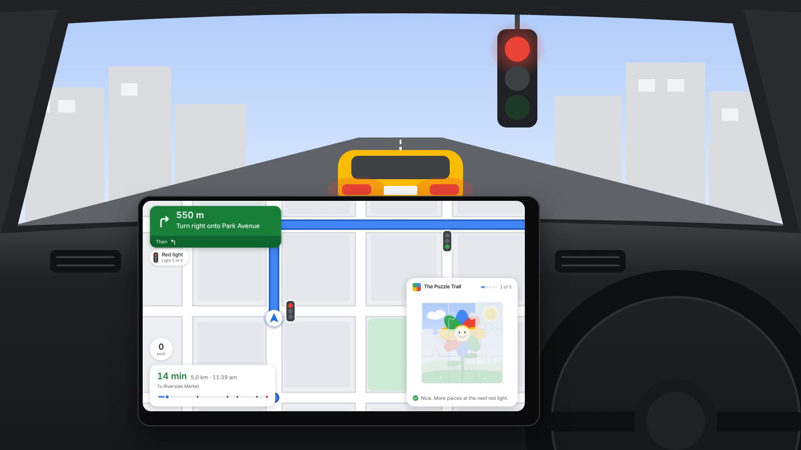

# The Puzzle Trail

**Your next red light has a missing piece.**

A student concept for Google Maps: a puzzle game that turns the wait at red lights into something worth waiting for. Over one journey, the driver builds a single picture, a few jigsaw pieces at each red light, and sees it complete on arrival.

**▶ Play the prototype:** https://raw.githack.com/nysharana/puzzle-trail/main/play.html

Or download [`play.html`](play.html) and open it in any browser. The whole prototype is in that one file.



A short film of the prototype in a car is in [`docs/demo-in-car.mp4`](docs/demo-in-car.mp4).

> This is a research concept. Routes, traffic signals and the car are simulated. It is not a Google product and not an approved in-car feature.

## How to try it

The page opens on a Google Maps-style dashboard with a destination already picked.

- **Play auto demo** (top right) drives the whole journey by itself: red lights, pieces turning in, green lights, and the finished picture on arrival.
- Or drive it yourself with the **Demo controls** under the dashboard. The blue button is always the next step:
  1. **Start journey**
  2. **Drive**
  3. **Stop at red light**: the puzzle opens after a moment. Tap a turned piece to rotate it into place.
  4. **Turn light green**: the puzzle disappears and your progress is saved.
  5. Repeat **Drive** and **Stop at red light** for each light, then **Arrive** to see the picture.
- Before starting, you can pick another destination in the search box (3, 5 or 9 traffic lights) and another picture (Flower, Smiley or Ice cream).

## The rules it follows

The puzzle opens only when all three are true: the car is stationary, the signal is red, and the stop is confirmed safe. As soon as the light turns green or the car moves, it disappears. There are no timers, scores or sounds, and nothing is lost between lights.

The puzzle splits itself across the lights on the route: a 9-piece picture for a short trip, 16 pieces for a long one. If a light turns out to be green, the remaining pieces are shared across fewer stops.

## Run it locally

You need [Node.js](https://nodejs.org) 18 or newer.

```bash
npm install
npm run dev      # open the local address it prints
npm run build    # builds a single self-contained file in dist/index.html
```

## How it's built

React, TypeScript and Tailwind CSS, bundled with Vite into one HTML file.

| Folder | What's in it |
| --- | --- |
| `src/sim/routes.ts` | The simulated map, routes, destinations and traffic lights |
| `src/sim/journey.ts` | The journey state: car, signals, the three safety conditions |
| `src/sim/puzzle.ts` | The jigsaw: pieces, turning, and how pieces are shared across red lights |
| `src/components/` | The map, navigation bar, puzzle panel, pictures, arrival screen and demo controls |
| `src/useAutoDemo.ts` | The hands-free demo |

The build is one self-contained file (`dist/index.html`). A copy of it is kept at the top of the repo as `play.html`.
